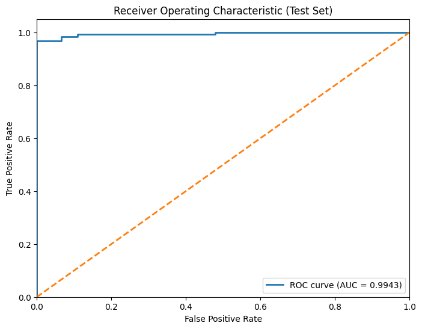

# MDD Detection Backend 🧠⚙️

FastAPI inference server for **AI-based Major Depressive Disorder (MDD) detection from 3D brain MRI**.
Part of the [MRI Depression Detection](../) project — this folder holds the model, inference API and Docker setup.

> Graduation project — BSc Computer Science (AI Track), King Khalid University.
> **Team:** [Fahad Al-Nahi](https://github.com/Skkinner), [Ibrahim Hurubi](https://github.com/Ibrahim-Hurubi), [Fahad Al-Mubarak](https://github.com/impx6f), [Abdullah AlShaharani](https://github.com/st1iv), [Ali Muyini](https://github.com/AliAhmed3140) · **Supervisor:** Dr. Mohamed Ghouse

## Results (independent test set, 217 subjects)

| Accuracy | AUC | Sensitivity | Specificity | F1 (macro) |
|:---:|:---:|:---:|:---:|:---:|
| **96.8%** | **0.994** | 94.4% | 100% | 0.97 |

<p align="center"></p>

Confusion matrix — Healthy: 92 / 92 correct · MDD: 118 / 125 correct.

## Training pipeline

The full training pipeline is in [`notebooks/MDD_Training_Pipeline.ipynb`](../notebooks/MDD_Training_Pipeline.ipynb) ([open in Colab](https://colab.research.google.com/drive/1TPpZR6kNmR0xnFOe9GZkL1iLTMxfgDuK)), trained on an NVIDIA A100:

1. **Data engineering** — fuse 3D gray-matter MRI maps (MNI152 space) with clinical metadata, stratified 80 / 10 / 10 split (1,732 / 217 / 217), normalisation fitted on the training set only to avoid leakage.
2. **Normative pretraining** — a 3D convolutional autoencoder is trained on Healthy Control scans only; its encoder becomes an "anatomical blueprint" that initialises the classifier.
3. **Multimodal training** — 60 epochs with multimodal MixUp, label smoothing, focal loss, AdamW, gradient clipping and cosine-annealing LR.
4. **Evaluation** — confusion matrix, classification report, ROC/AUC, sensitivity and specificity on the held-out test set.

## How it works

The model is a **multimodal late-fusion network** written in PyTorch:

```
3D MRI (NIfTI) ──► 3D CNN encoder (4 × Conv3d + BN + ReLU) ──► SE attention ──► 128-d ─┐
                                                                                      ├─► concat (160-d) ──► MLP + Dropout ──► P(MDD)
Clinical data (sex, age, education, HAMD) ──► MLP encoder ──────────────────► 32-d ───┘
```

- **Preprocessing:** min-max normalisation, resize to 64³ with MONAI, z-score standardisation.
- **Explainability:** 3D **Grad-CAM** on the image encoder, upsampled to the original scan size with trilinear interpolation and masked by brain structure, returned as a NIfTI heatmap so the frontend can overlay it on the scan.

## API

`POST /api/analyze` (multipart form)

| Field  | Type  | Description                         |
|--------|-------|-------------------------------------|
| `file` | file  | Brain MRI in `.nii` / `.nii.gz`     |
| `sex`  | float | Sex (encoded)                       |
| `age`  | float | Age (normalised)                    |
| `edu`  | float | Years of education (normalised)     |
| `hamd` | float | Hamilton Depression Rating score    |

Response:

```json
{
  "diagnosis": "Depression Signs Detected",
  "confidence": 87.4,
  "heatmap": "<base64 NIfTI>"
}
```

## Run locally

```bash
python -m venv venv && source venv/bin/activate
pip install -r requirements.txt
python main.py            # http://localhost:8000/docs
```

Or with Docker:

```bash
docker build -t mdd-backend .
docker run -p 8000:8000 mdd-backend
```

## Tech stack

PyTorch · MONAI · NiBabel · NumPy · FastAPI · Uvicorn · Docker

## ⚠️ Disclaimer

This is a research and educational project. It is **not** a medical device and must not be used for clinical diagnosis.
